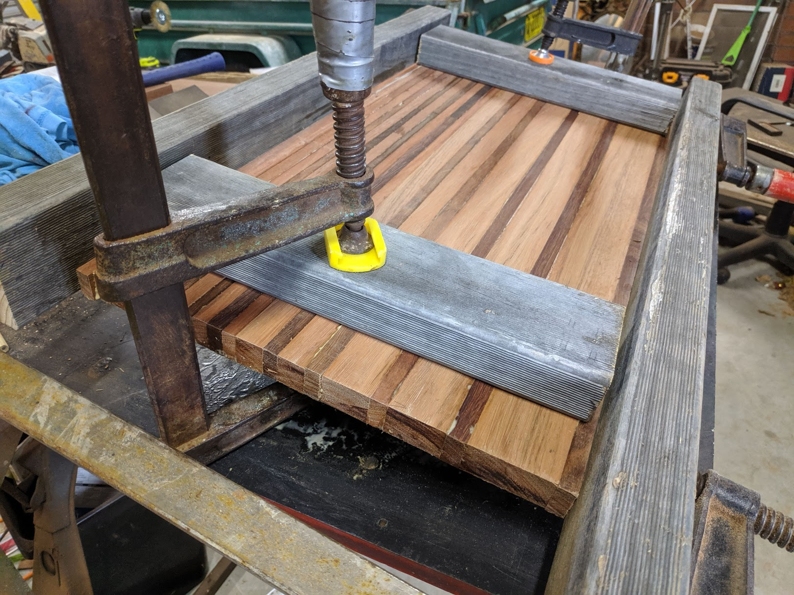
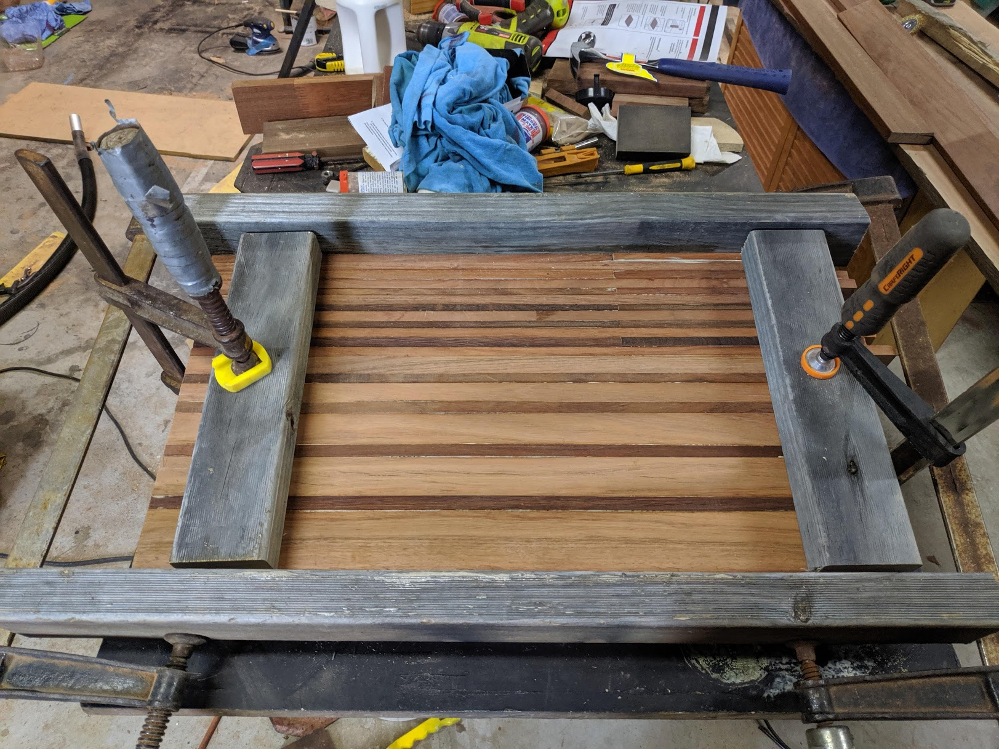
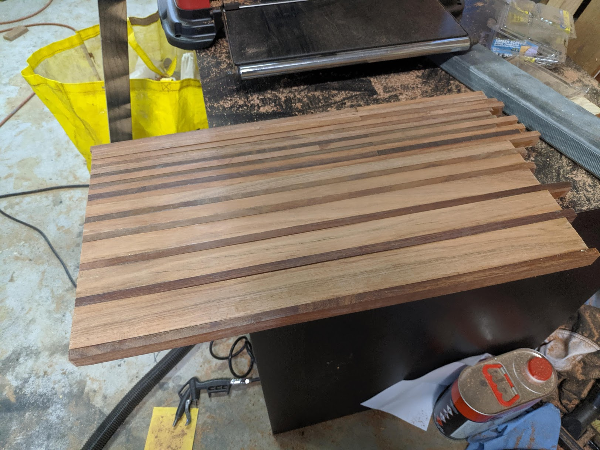
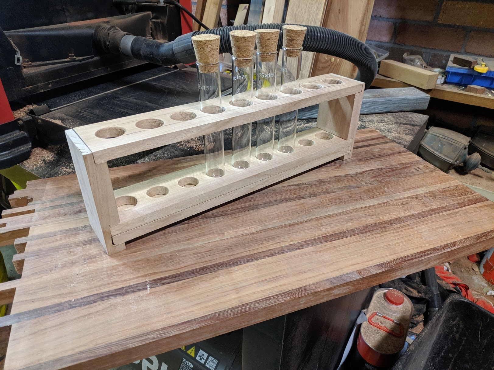
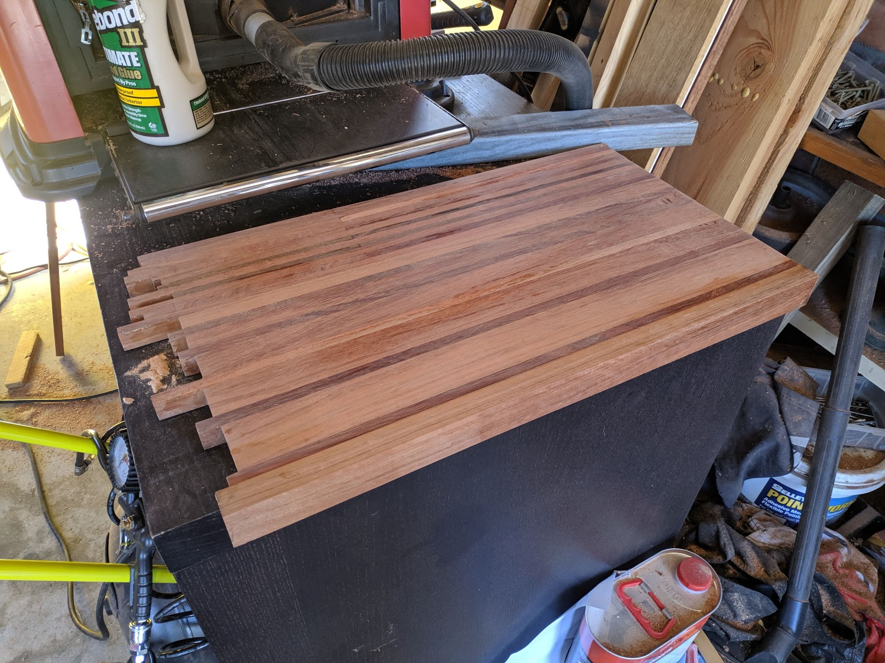
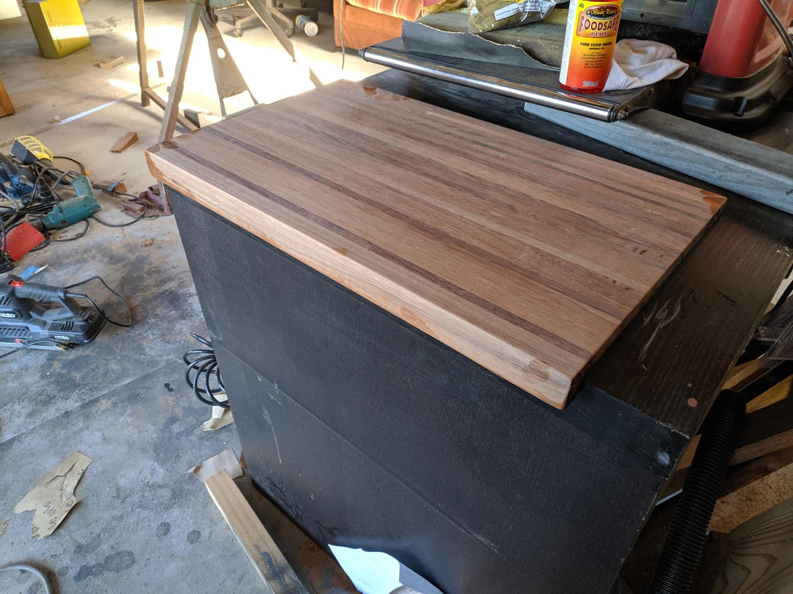
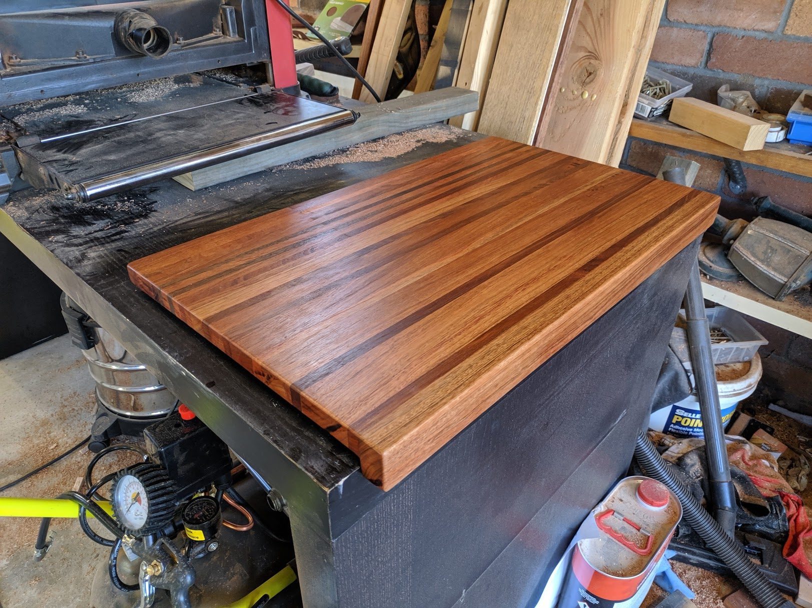
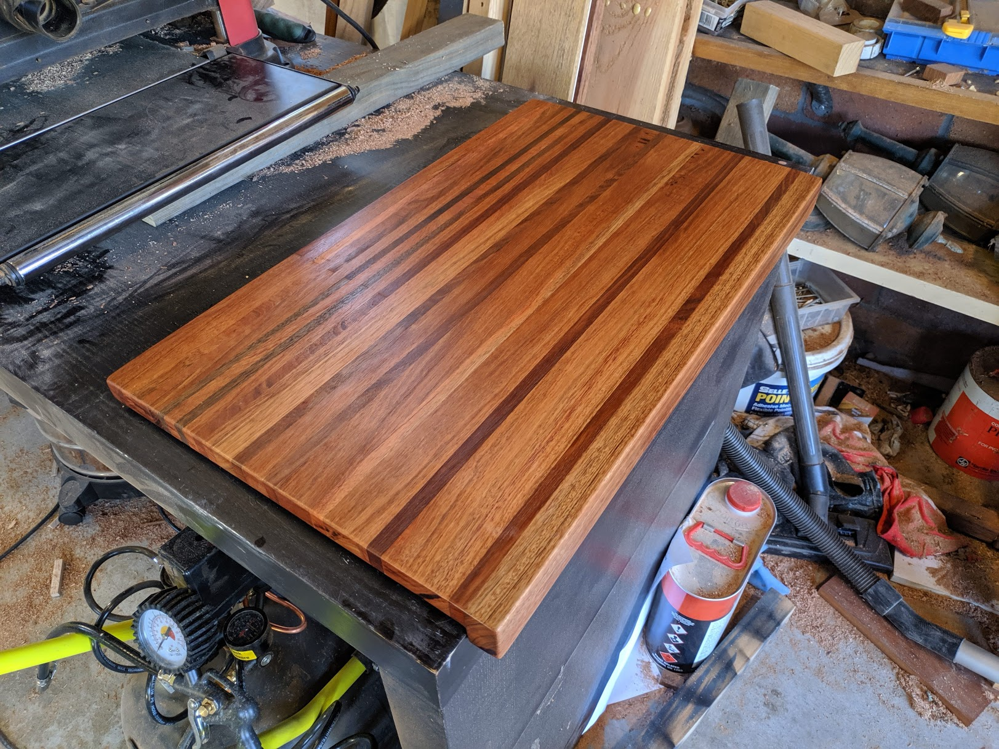
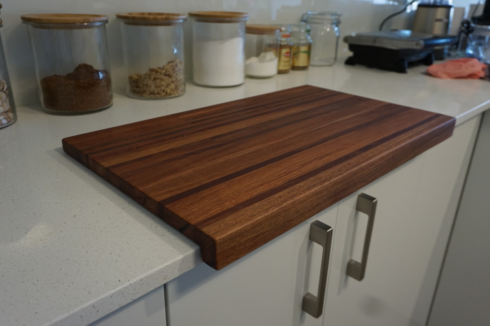

A Chopping board made from scrap red iron bark.

organise the scrap lengths by colour and identify a pattern.

 

Glue thoroughly and clamp top down and depth wise.

 

Give it at least a day to dry.

 

Sand the top and bottom surface till relatively flat. A thicknesser will make quick work of this.

 

A thicker length of ironbark glued to the front give a lip that prevents the board from mmoving on the benchtop.

 

A mitre saw squares off each end. A 75 degree angle is used.

 

Give the board one last sand and then apply food safe mineral oil

 

Add a second layer of oil, wwait for it to be absorded, then wipe off the excess.

 

Enjoy your new cutting board.

 

Apply additional mineral oil as needed.
