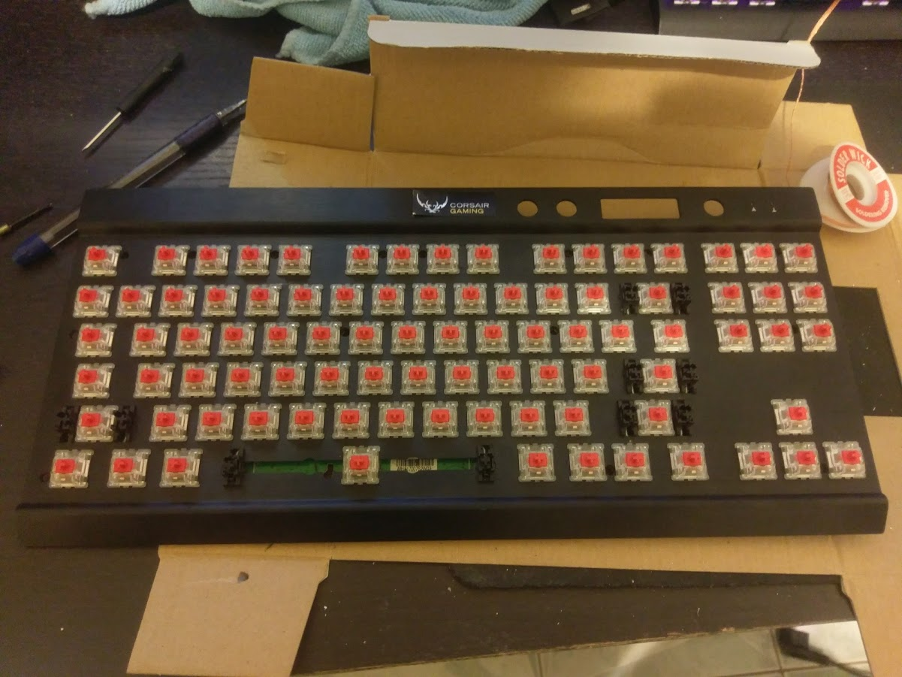
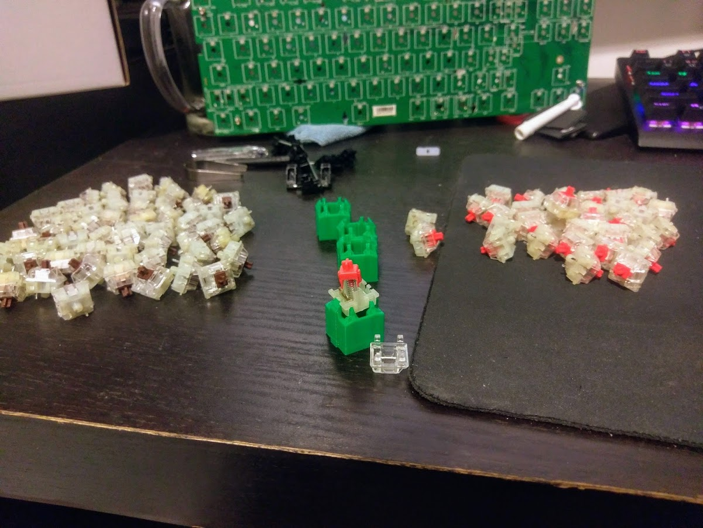
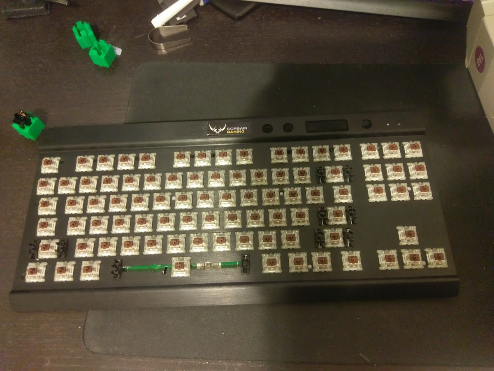
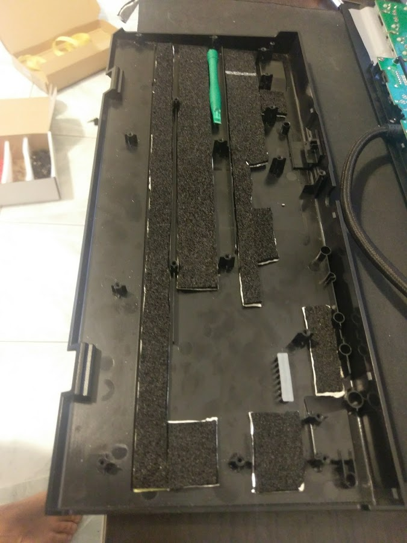
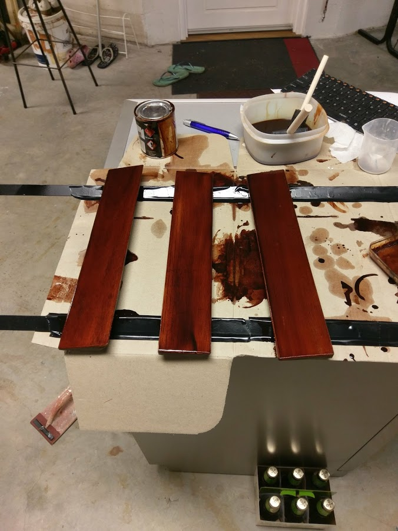

A modified Corsair RGB K65 with the following improvements.
- Cherry MX Brown switches
- silenced stabilizers
- PBT Grey and Blue Keycaps
- O-ring silencers
- Matt dampening in enclosure,

Remove the original keycaps, open the enclosure and desolder each switch.

 

These cheery Brown switches were non RGB and didn't have a clear cover. Open each brown switch and place the spring and stem inside the enclosure of the original red switches.
its a good idea to lube these switches with silicone grease while they are open.

 

Resolder all of the new hybid brown switches onto the board.

 

Use silverstone dampening material in the bottom of the enclosure.

 

The palm rest are carved from Tasmanian Oak. A jarrah stain gives it a vivid colour.

 

Finish the palm rest with a few coats of Duplicolor automotive clear coat. This will provide enough protection for everyday use

 
