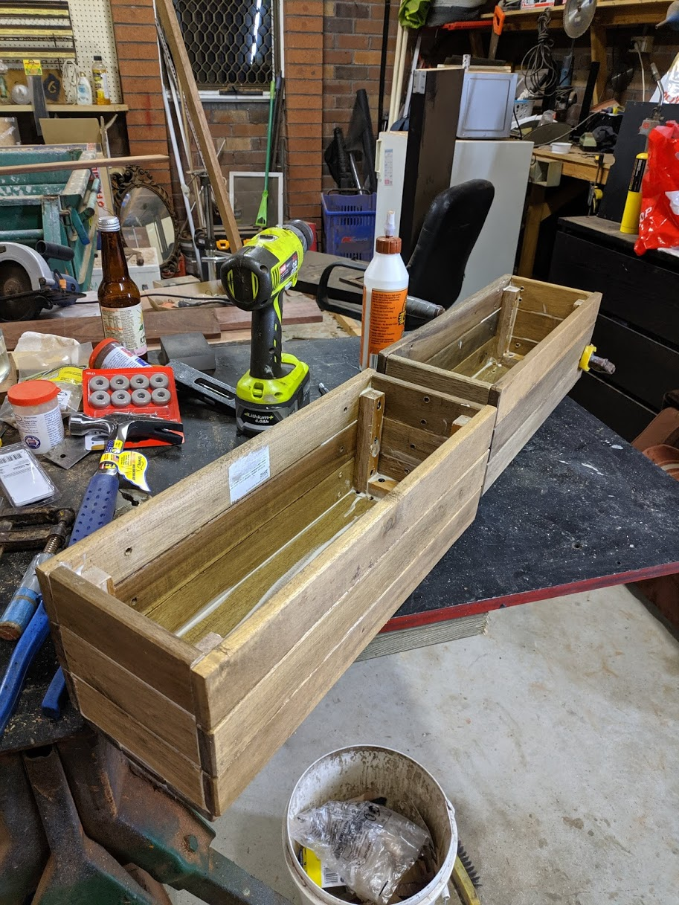
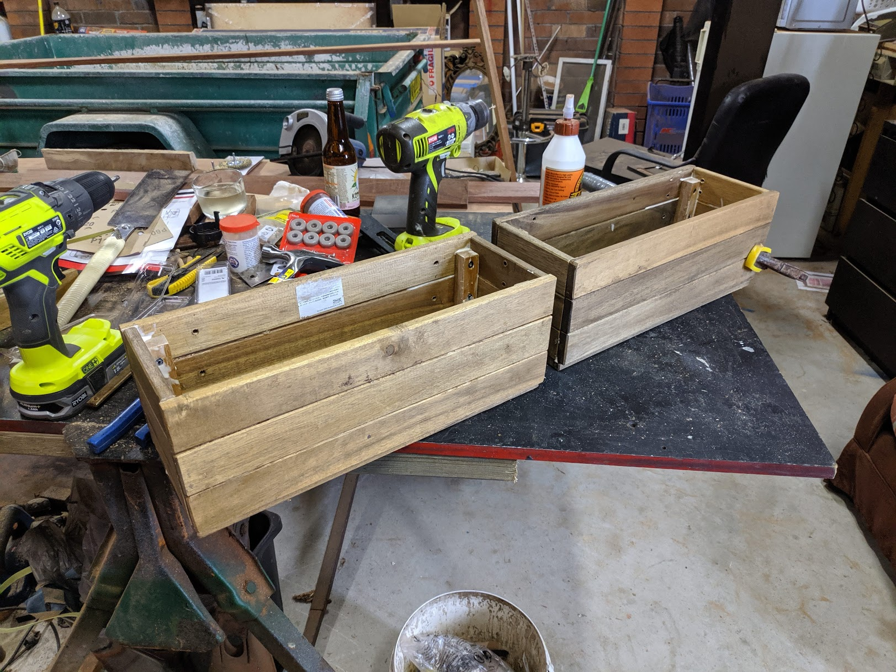
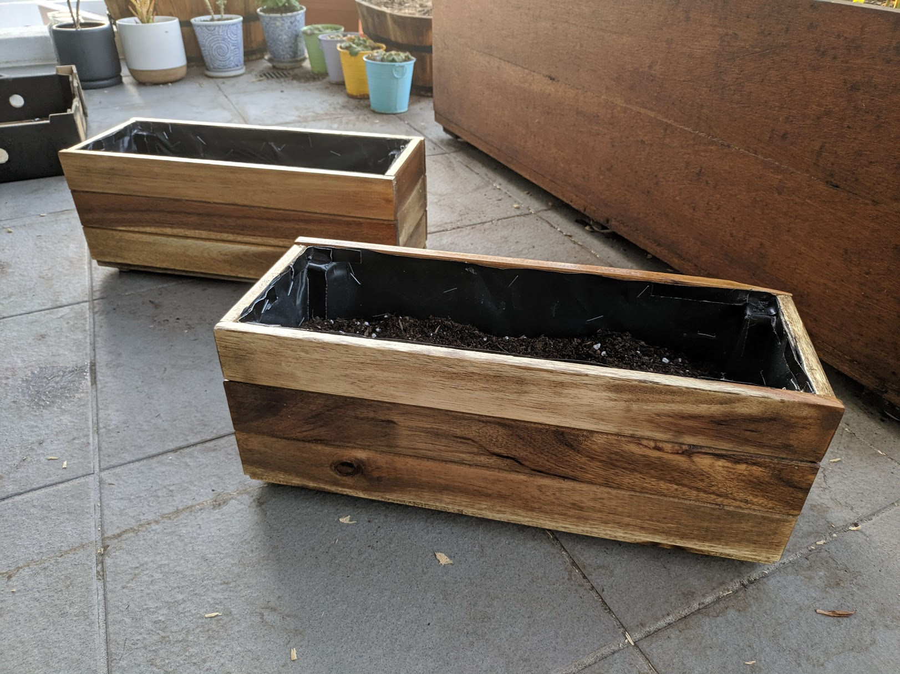

A simple project using acacia wood panels from Ikea tarno chairs.

Cut the lengths to size. Use an internal stake to brace each corner.

 

Use glue, clamps and 16mm 6g screws as required.

 

Coat in 3-4 heavy layers of danish oil to improve waterproofing and outdoor longevity.
use pondliner or HDPE plastic as an internal liner. staple into place. drill a drainage hole and waterproof.

 

