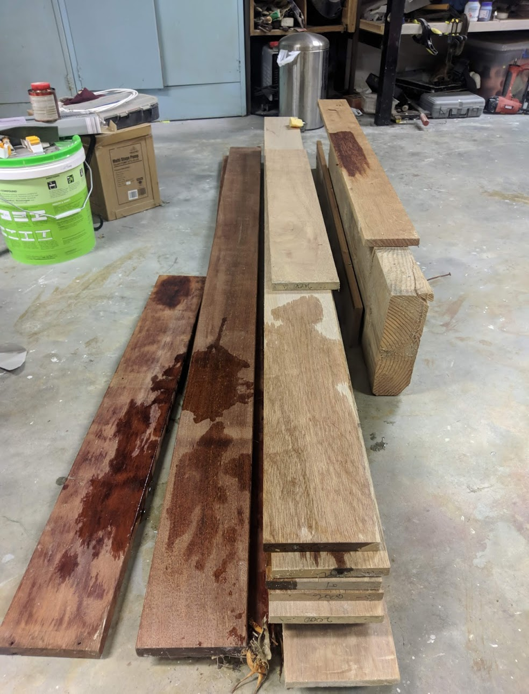
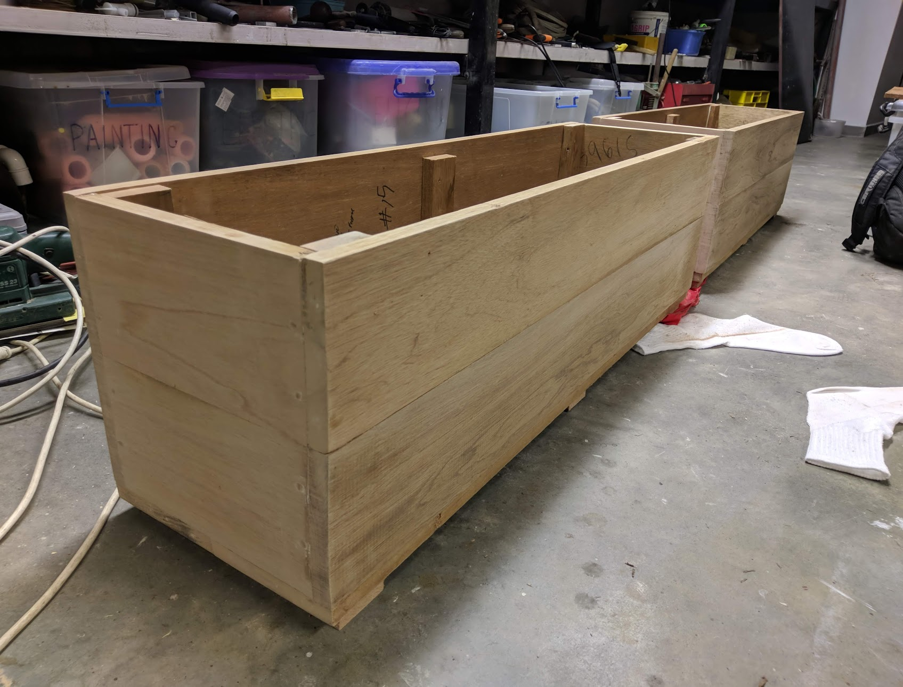
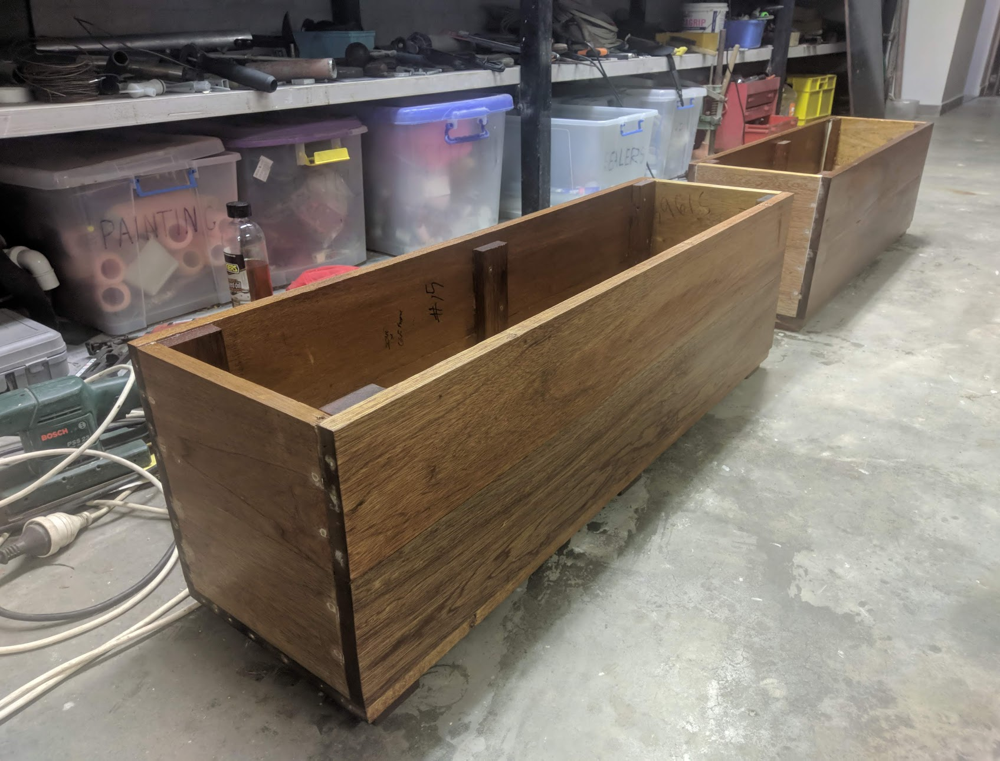
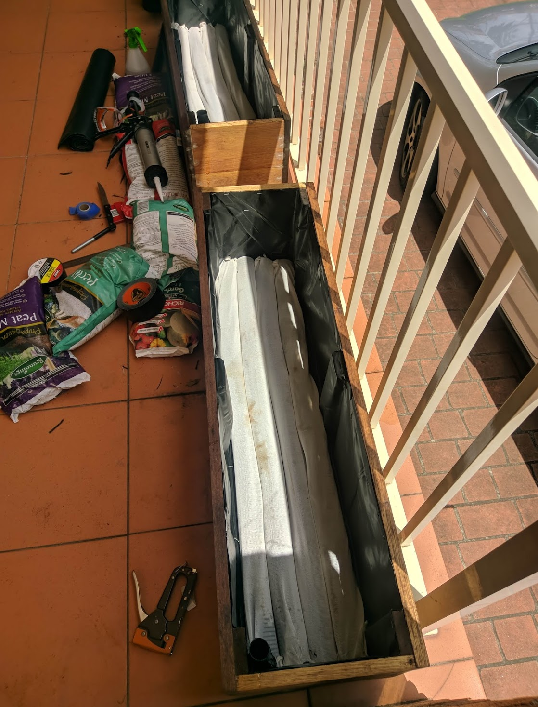
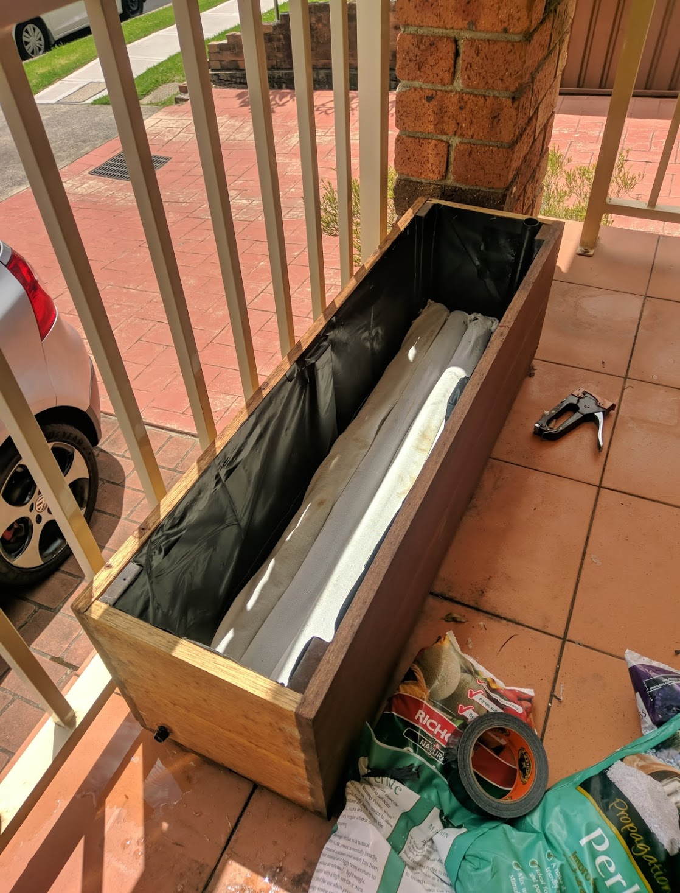
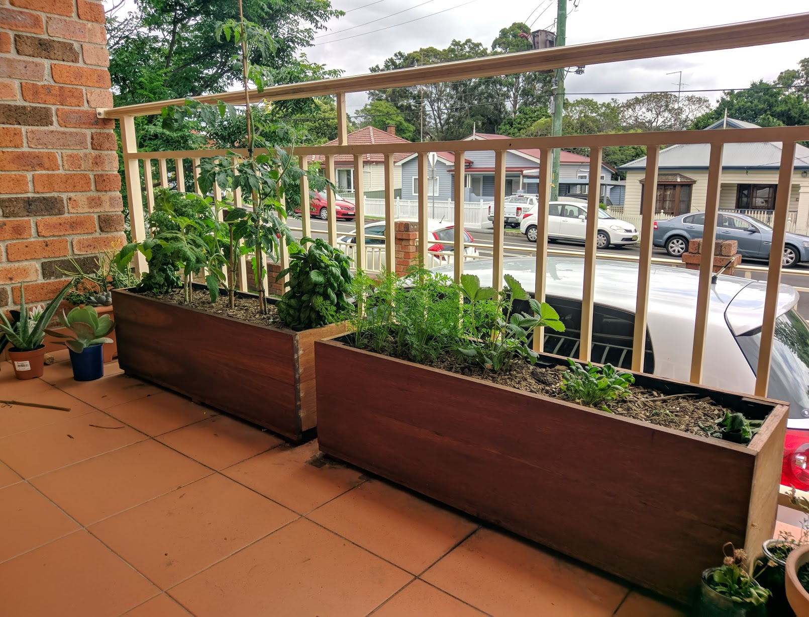

This is a self watering planter box made from scrap meranti.

 

The planter should be at least 300mm tall to ensure the roots dont get flooded.
Cut the lengths to size. Use an internal stake to brace each corner and screw into and glue.

 

Oil the wood with linseed oil. Apply 2-3 coats. This should offer great outdoor protection but will need to be reapplied ever 2 years or so.

 

line the internal surface with food safe pond liner.
place lengths of 65mm socked drainage tube on the bottom, minimizing gaps where possible.

 

Add a 2cm drainage tube around 3/4ths the way up the socked tubing. This allows over watering to be expelled.

 

A specialized potting mix must be used. it must be light and aerated to ensure the planter does not become too wet.
This requires a combination of 50% potting mix, 22% peat moss, 22% perlite, 5% vermiculite, 1% lyme( to counter the acidity of the peat moss)
This mix will prevent root rot and will allow for watering every 5 days or so.

 
