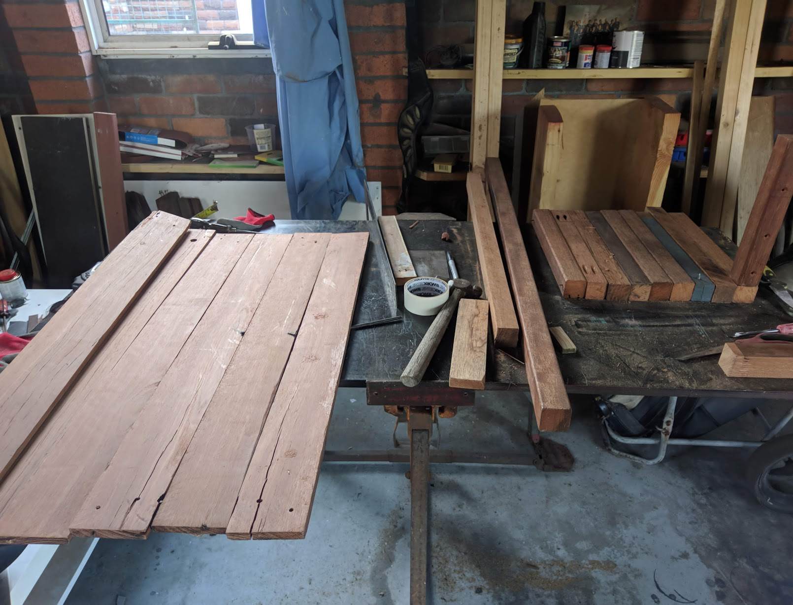
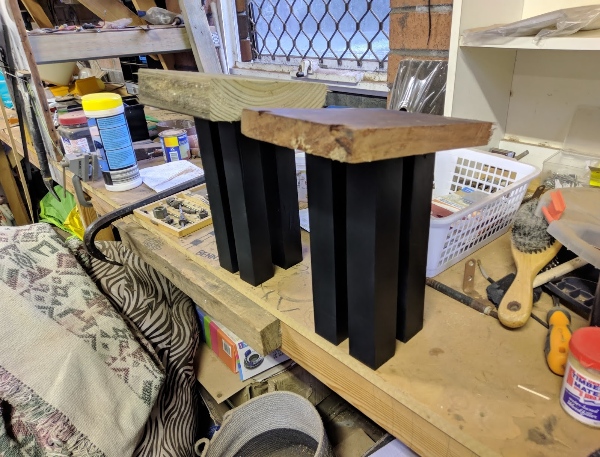
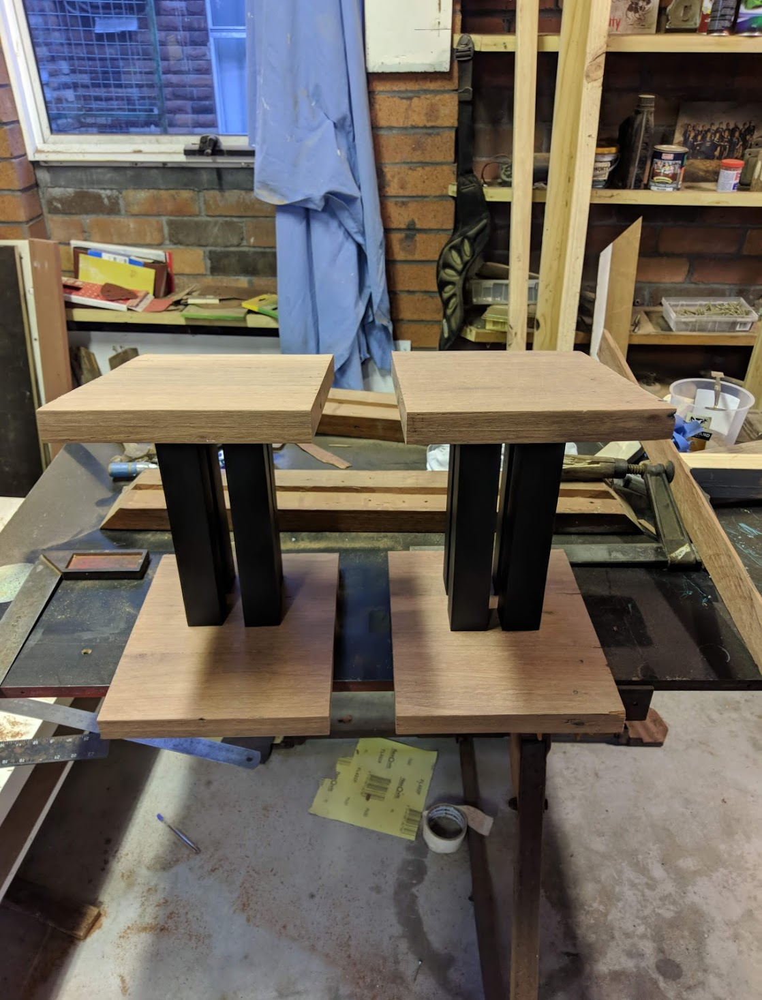
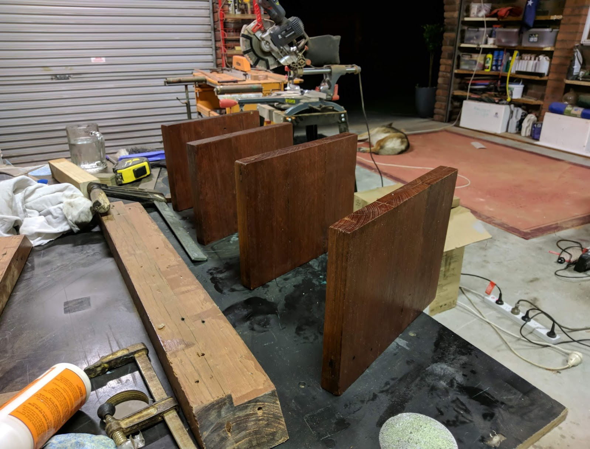
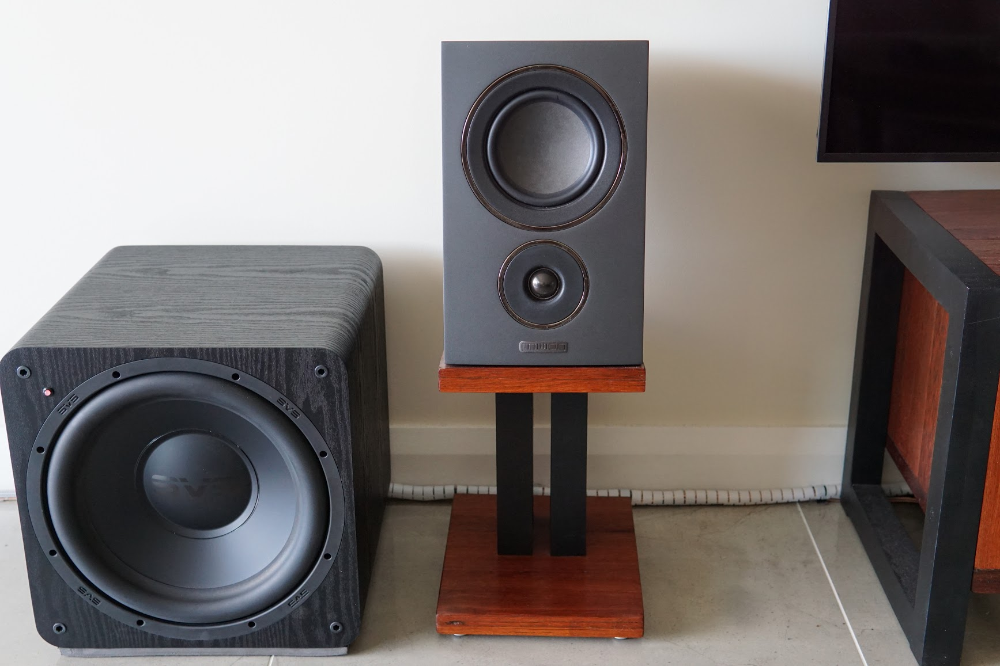

Angled speaker stands made of RedGum and merbau.
Designed for the tweeter to aim at ear height 2m from the speaker.

 

35x35mm merbau beams are used for the quad vertical posts
The merbau posts are primed and coated in Duplicolor matte black. They are cut at a 7 degree angle.

 

90x14mm Red Gum lengths are laminated length and depth wise to create 28mm panels
Check the fitment with the posts.

 

Sand the panels with 80, 150 and then 240 grit sandpaper.
Apply 3 coats of Danish oil spaced a day apart.
Wait a week till it is completely dry, then apply 4-5 coats of Minwax wipe on satin poly.

 

Screw the panels together and enjoy your new speaker stands.

 

