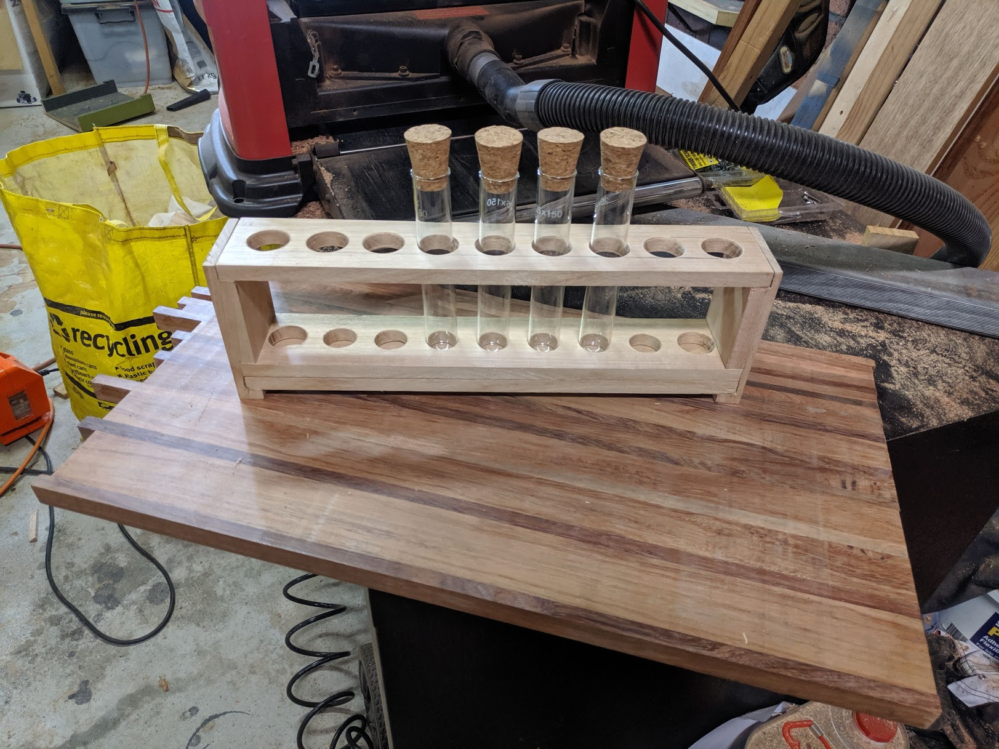
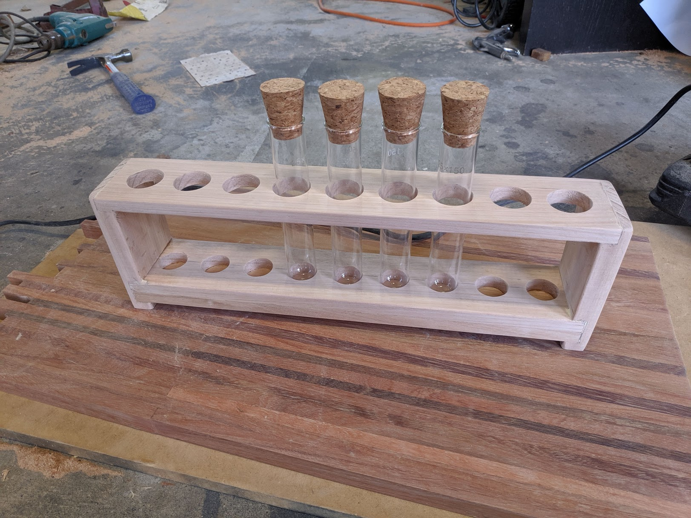
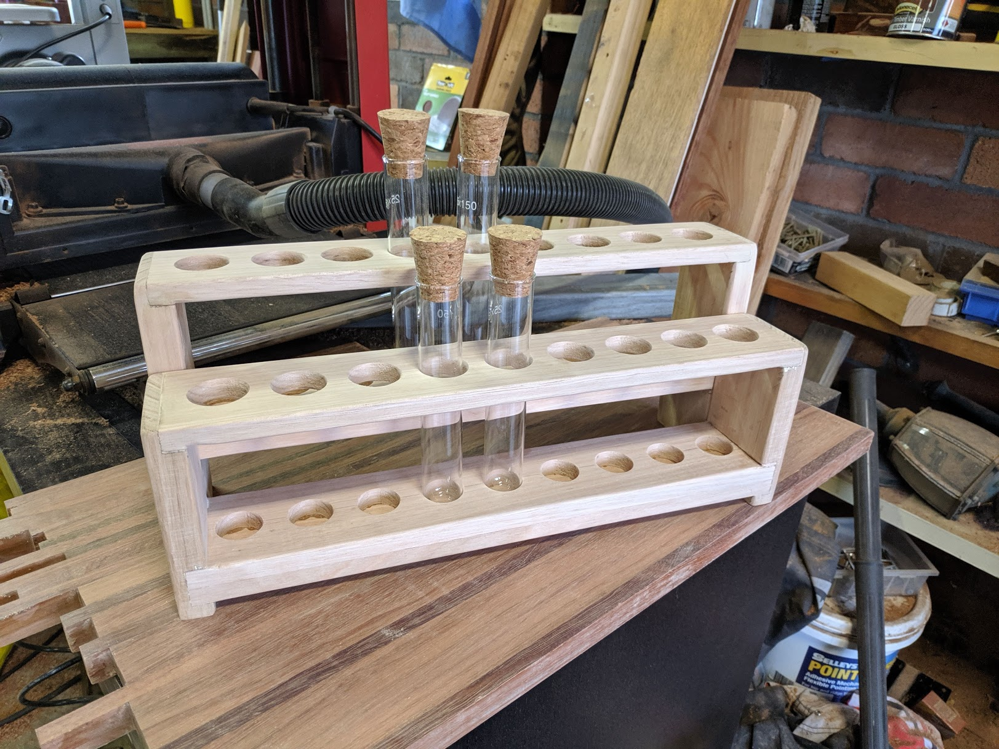
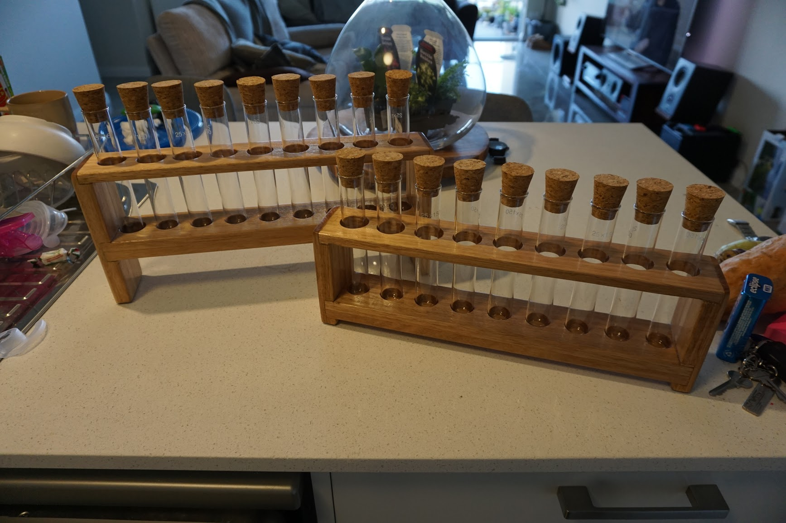
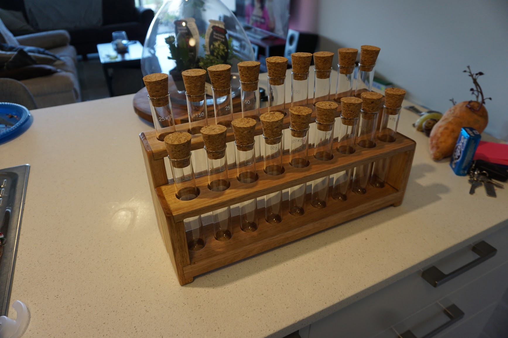

A test tube spice rack made from Tasmanian oak.
Holds 18 different spices in 25x150mm test tubes

Made from a length of 65x19mm Tasmanian oak DAR
65x12mm Tasmanian oak DAR

The vertical portions are made up of the 19mm oak. A band saw is used to make the joint.
The top horizontal portion is made of the 19mm oak. 27mm holes are spaced out in 40mm increments. Use a drill press for the most accurate results.
The bottom horizontal mean is a sandwich of two 12mm lengths. The topmost length has matching hole spacings.

 

Once fit and finish looks good, glue the pieces together. Use a sander to round the corners.

 

Repeat with taller vertical lengths for the rear rack.

 

Add three layers of Danish oil over 3 days to complete the finish.

 

Add the test tubes and corks. Ensure everything aligns correctly.

 

Enjoy your new spice rack 