An entertainment unit made from an old red gum shop table and merbau 35x35mm lengths.

Pulled apart the original table.

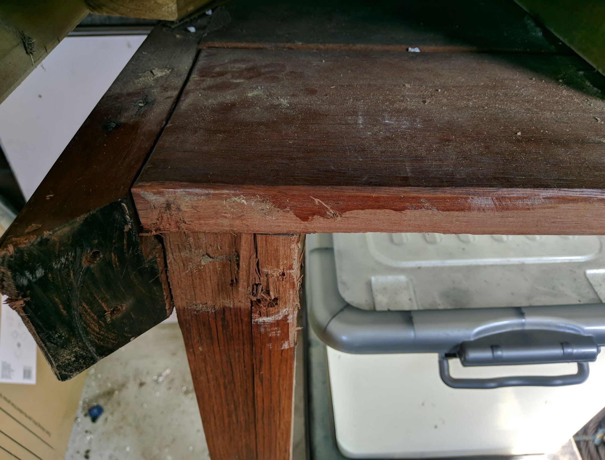 

Checked what a danish oil finish would look like with a small sample
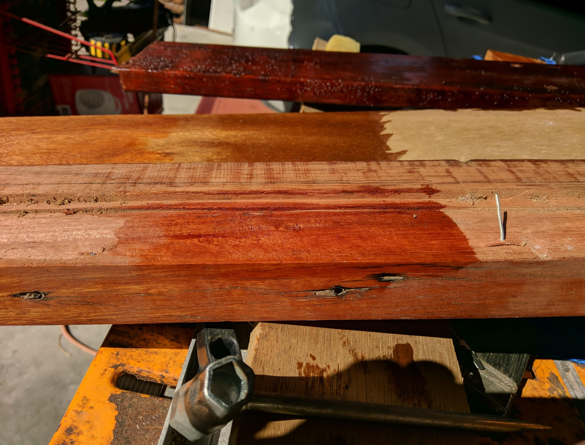 

Completely Sand back the 4 main panels. Each panel was very warped and its thickness varied massively from 20-40mm.

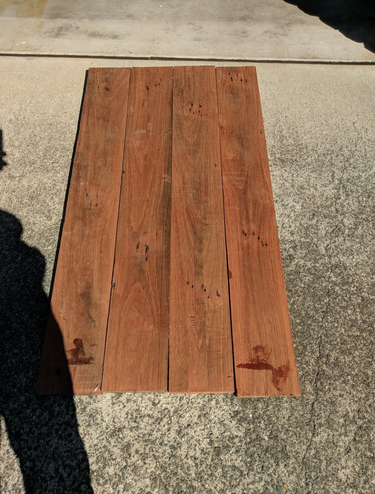 

Laminate the panels together. A merbau length was sandwiched in the middle to increase the depth of the final board and add some colour variation. Hide the panel thickness variations on the bottomside where it wont be seen.

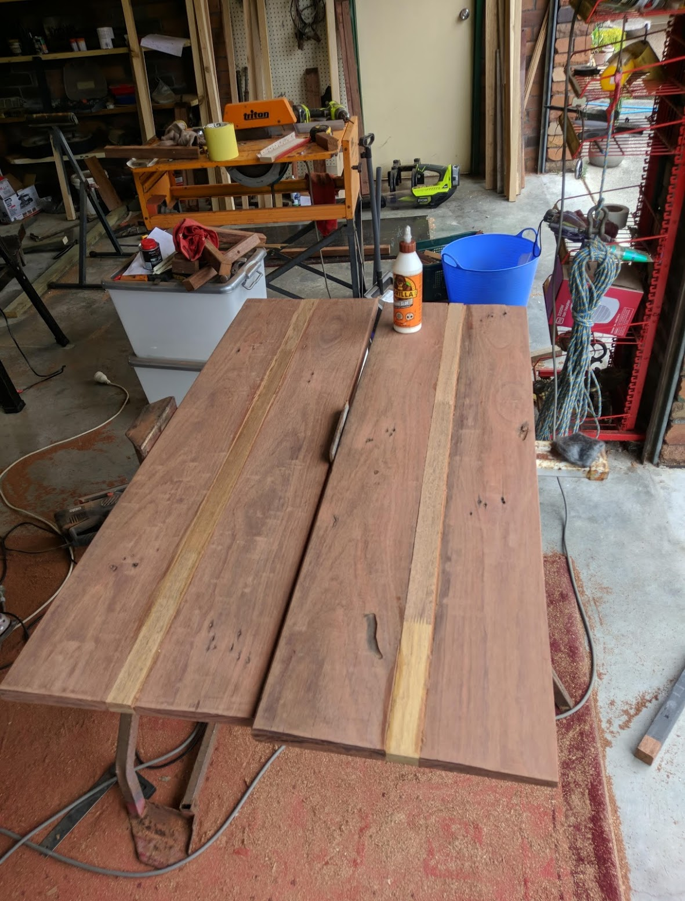 

A quick coat of danish oil on the laminated panel to see what the merbau red gum combination would look like.

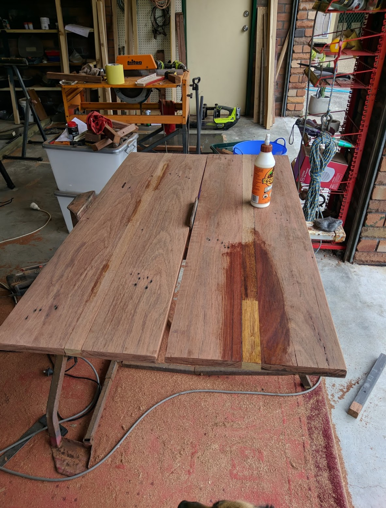 

Laminate the side panels, again with a merbau core.

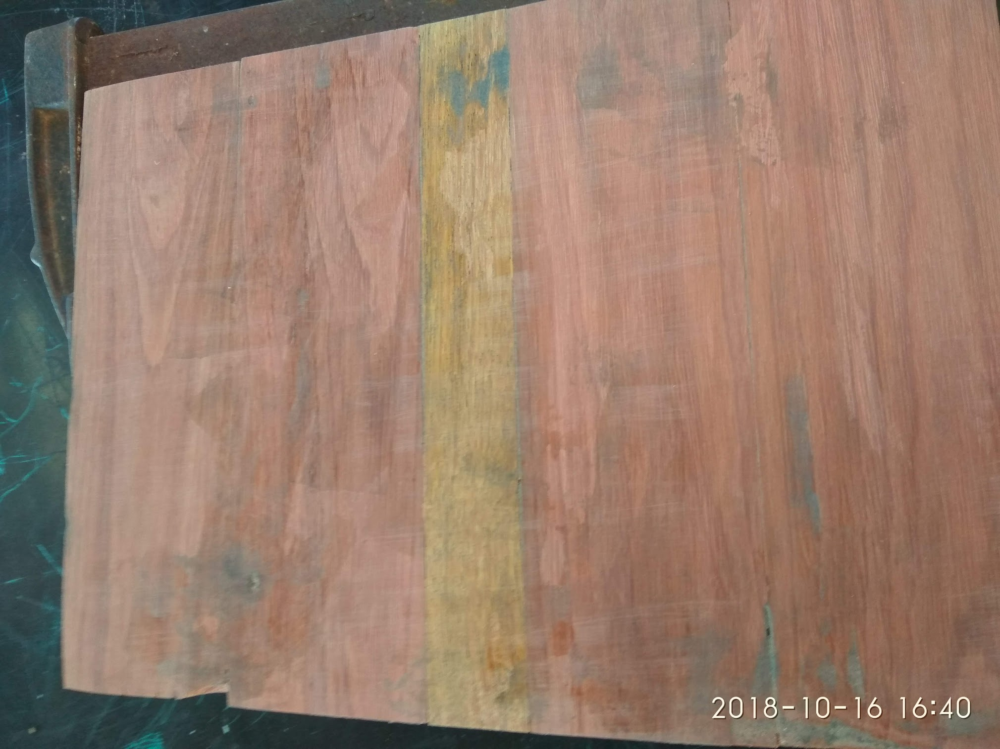 

Glue and clamp the main and side panels. A merbau length is secured in the middle rear with pocket holes to provide strength

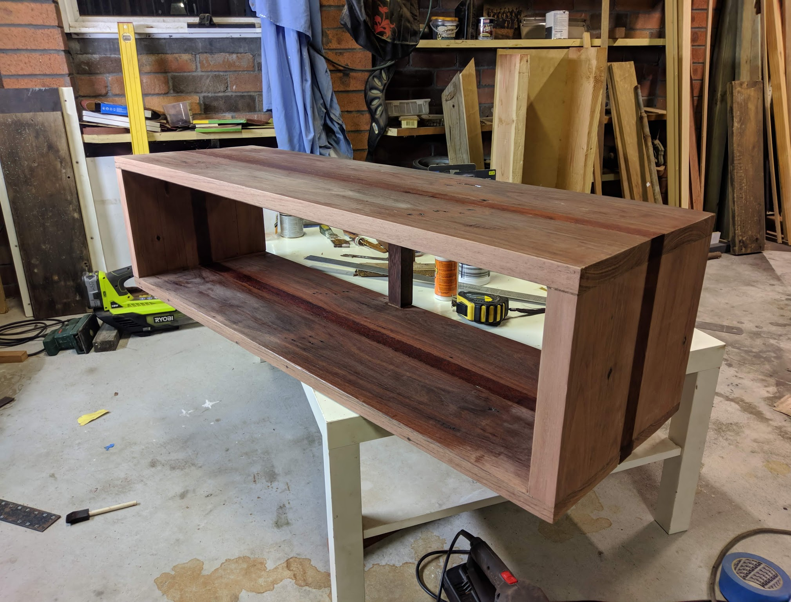 

Finish off the piece with 3 coats of danish oil.

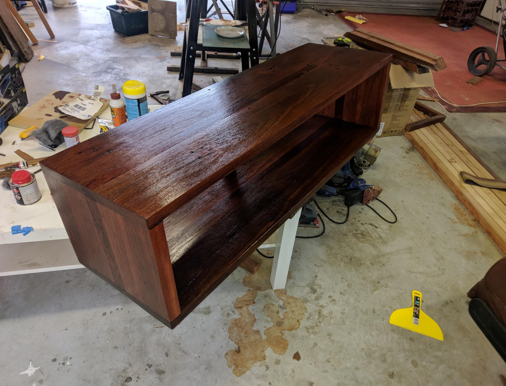 

Wait a week for the danish oil to completely dry, and apply 4-5 coats of satin oil based wipe on poly.

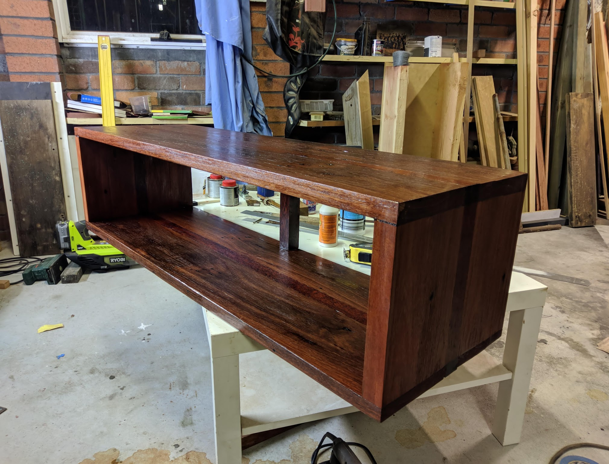 

The final coat.

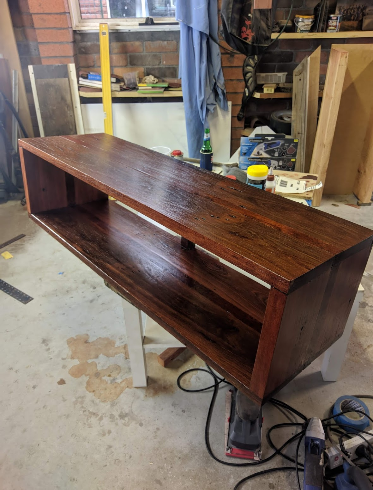 

square merbau legs are added.

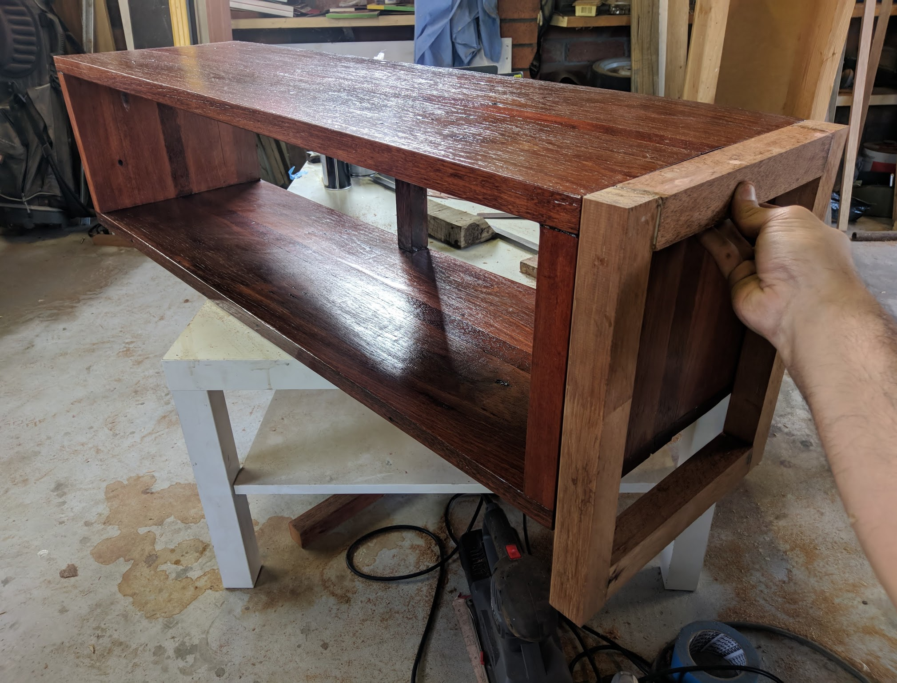 

The legs are painted in undercoat primer, then duplicolor automotive matte black. This gives off the appearance of powdered steel.

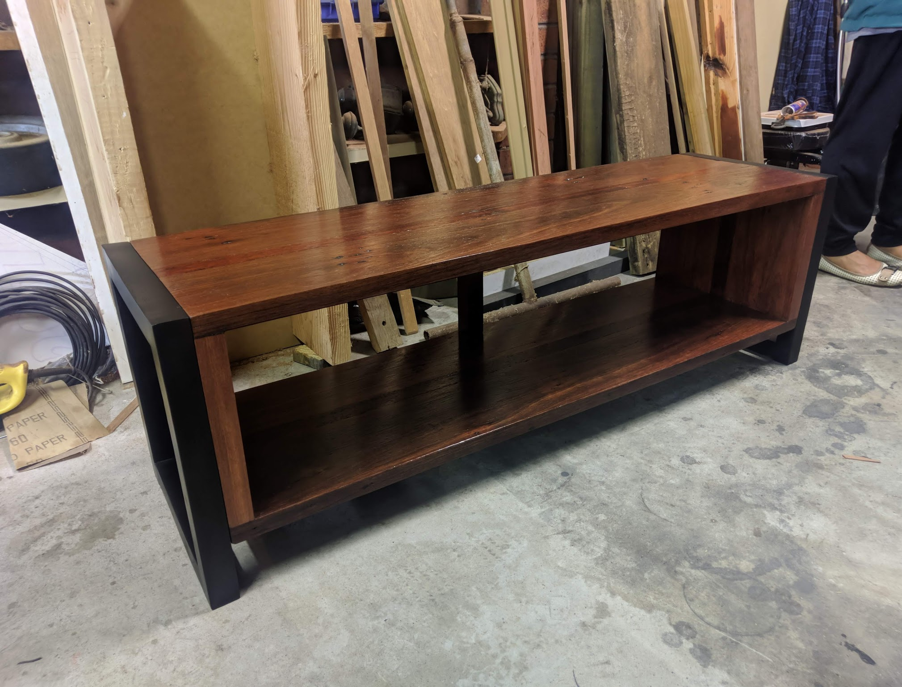 

Enjoy the finished product.

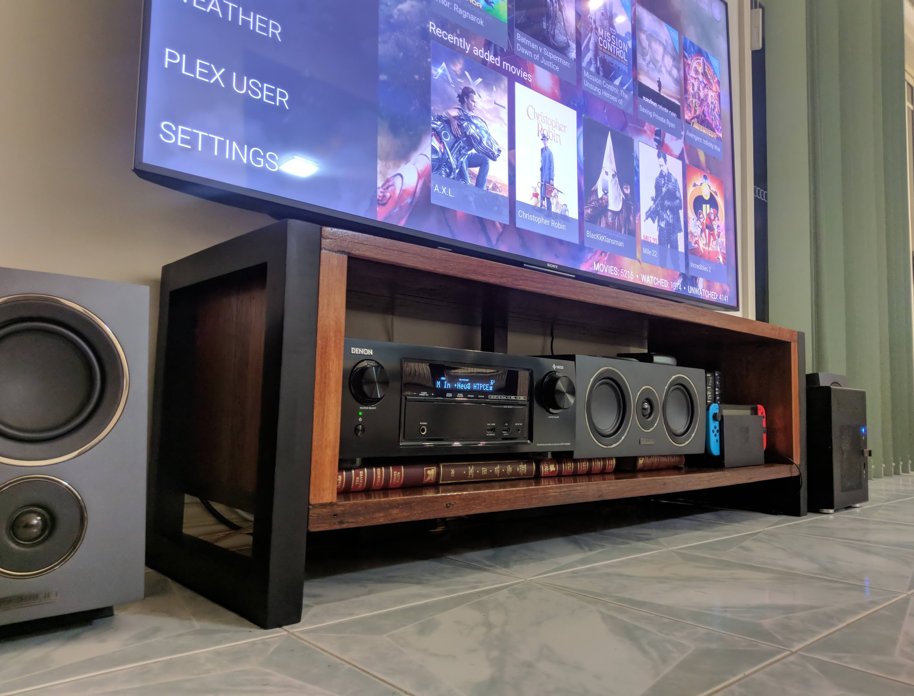 

